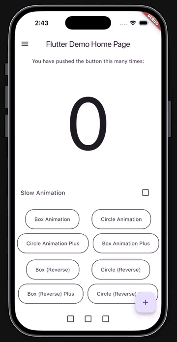

# animated_theme_switcher_plus

[](https://pub.dev/packages/animated_theme_switcher_plus)
[](LICENSE)

Animated theme switching for Flutter. Change `ThemeData` anywhere in your app and the new theme
sweeps across the screen from the exact point the user touched — instead of snapping over instantly.

Two rendering modes ship in the box:

- **Classic reveals** — a hard-edged circle or box grows from the tap point via `ClipPath`.
- **Premium reveals** — a soft, feathered `ShaderMask` wipe with a depth-bloom scale on the incoming
  theme and a receding fade on the outgoing one. No hard edge, no visible clip boundary.



## Features

- Reveal animation anchored to the **exact tap coordinates**, not the widget centre
- **Feathered `ShaderMask` reveals** (`Premium`) for circle and box, with soft gradient edges
- **Forward and reverse** playback — reveal the new theme, or peel the old one away
- Pluggable **custom clipper** interface for your own reveal shapes
- Works with **any number of themes**, not just light/dark
- No dependencies beyond Flutter itself
- Proper `AnimationController` disposal — no leaks, no debug-mode assertions

## Installation

Requires Flutter 3.10 or newer (Dart 3).

```yaml
dependencies:
  animated_theme_switcher_plus: ^1.0.0
```

```dart
import 'package:animated_theme_switcher_plus/animated_theme_switcher_plus.dart';
```

## Quick start

Three widgets cooperate. `ThemeProvider` owns the animation, a switching area is the stage the
animation plays on, and `ThemeSwitcher` is the thing the user taps.

### 1. Wrap your app in `ThemeProvider`

```dart
ThemeProvider(
  initTheme: lightTheme,
  duration: const Duration(milliseconds: 600),
  builder: (_, theme) => MaterialApp(
    theme: theme,
    home: const HomePage(),
  ),
);
```

If you only need to *provide* a theme without a `MaterialApp` in between, pass `child` instead of
`builder`:

```dart
ThemeProvider(
  initTheme: lightTheme,
  child: const SomePage(),
);
```

### 2. Wrap the screen in a switching area

For the feathered reveals:

```dart
PremiumThemeSwitchingArea(
  child: Scaffold(...),
);
```

Or, for the classic hard-edged clip:

```dart
ThemeSwitchingArea(
  child: Scaffold(...),
);
```

### 3. Trigger the switch

```dart
ThemeSwitcher(
  clipper: const ThemeSwitcherCircleClipper(),
  builder: (context) => IconButton(
    icon: const Icon(Icons.brightness_6),
    onPressed: () => ThemeSwitcher.of(context).changeTheme(theme: darkTheme),
  ),
);
```

## Premium reveals

`PremiumThemeSwitchingArea` renders a feathered `ShaderMask` wipe whenever the active clipper is one
of the two **Plus** clippers. Any other clipper falls back to classic `ClipPath` rendering in the
same widget, so you can mix both styles on one screen without swapping the area out.

| Clipper | Rendering under `PremiumThemeSwitchingArea` |
| --- | --- |
| `ThemeSwitcherCirclePlusClipper` | Feathered radial reveal |
| `ThemeSwitcherBoxPlusClipper` | Feathered rectangular reveal |
| `ThemeSwitcherCircleClipper` | Classic hard-edged circle |
| `ThemeSwitcherBoxClipper` | Classic hard-edged box |
| your own `ThemeSwitcherClipper` | Classic path clip |

Trigger a premium reveal through the static helper rather than `ThemeSwitcher.of(context)` — it
manages the longer animation duration and restores your original duration when the reveal finishes:

```dart
ThemeSwitcher(
  clipper: const ThemeSwitcherCirclePlusClipper(),
  builder: (context) => GestureDetector(
    onTapDown: (details) {
      final model = ThemeModelInheritedNotifier.of(context);
      PremiumThemeSwitchingArea.changeTheme(
        context,
        theme: model.theme.brightness == Brightness.light ? darkTheme : lightTheme,
        offset: details.localPosition,
      );
    },
    child: const Text('Switch'),
  ),
);
```

`PremiumThemeSwitchingArea.changeTheme` accepts:

| Parameter | Default | Description |
| --- | --- | --- |
| `theme` | required | The `ThemeData` to switch to |
| `offset` | widget centre | Reveal origin, local to the `ThemeSwitcher` |
| `isReversed` | `false` | Play the reveal backwards |
| `duration` | `premiumDuration` (2000 ms) | Controller duration for this reveal |

Calls are **dropped, not queued**, while an animation is in flight — tapping repeatedly mid-reveal
is a no-op rather than a stutter.

## Anchoring to the tap point

Pass `offset` from a `TapDownDetails` to make the reveal originate exactly where the finger landed.
Omit it and the reveal starts from the centre of the `ThemeSwitcher`.

```dart
GestureDetector(
  onTapDown: (details) => ThemeSwitcher.of(context).changeTheme(
    theme: darkTheme,
    offset: details.localPosition,
  ),
  child: const Text('Switch'),
);
```

## Reverse playback

`isReversed: true` inverts the layer order: instead of the new theme growing over the old, the old
theme shrinks away to expose the new one already sitting underneath. Pairing the direction with
brightness gives a switch that feels symmetric — light expands, dark contracts:

```dart
final brightness = ThemeModelInheritedNotifier.of(context).theme.brightness;

ThemeSwitcher.of(context).changeTheme(
  theme: brightness == Brightness.light ? darkTheme : lightTheme,
  offset: details.localPosition,
  isReversed: brightness == Brightness.dark,
);
```

## Convenience builders

`ThemeSwitcher.switcher()` hands you the switcher directly, and `ThemeSwitcher.withTheme()` hands
you the current theme as well — so you don't need a nested `ThemeModelInheritedNotifier.of(context)`
lookup just to read the active brightness:

```dart
ThemeSwitcher.switcher(
  builder: (context, switcher) => IconButton(
    icon: const Icon(Icons.palette),
    onPressed: () => switcher.changeTheme(theme: pinkTheme),
  ),
);

ThemeSwitcher.withTheme(
  builder: (context, switcher, theme) => IconButton(
    icon: const Icon(Icons.brightness_6),
    onPressed: () => switcher.changeTheme(
      theme: theme.brightness == Brightness.light ? darkTheme : lightTheme,
    ),
  ),
);
```

## Custom clippers

Implement `ThemeSwitcherClipper` and return a `Path` that grows with `sizeRate` (0 → 1):

```dart
class DiamondClipper implements ThemeSwitcherClipper {
  const DiamondClipper();

  @override
  Path getClip(Size size, Offset offset, double sizeRate) {
    final r = size.longestSide * 2 * sizeRate;
    return Path()
      ..moveTo(offset.dx, offset.dy - r)
      ..lineTo(offset.dx + r, offset.dy)
      ..lineTo(offset.dx, offset.dy + r)
      ..lineTo(offset.dx - r, offset.dy)
      ..close();
  }

  @override
  bool shouldReclip(CustomClipper<Path> oldClipper, Offset offset, double sizeRate) => true;
}
```

Then pass it to any `ThemeSwitcher`:

```dart
ThemeSwitcher(
  clipper: const DiamondClipper(),
  builder: (context) => ...,
);
```

Extend `ThemeSwitcherClipper` rather than Flutter's `CustomClipper<Path>` directly — the package
adapts it internally via `ThemeSwitcherClipperBridge`.

## How it works

Before each switch the package captures the current screen as a `ui.Image` from a `RepaintBoundary`
placed above your `MaterialApp`. That screenshot becomes the *outgoing* layer, and your live widget
tree — already rebuilt under the new `ThemeData` — is stacked above or below it. Animating a clip
path or a shader mask between the two layers produces the reveal. Once the controller finishes, the
screenshot layer is dropped from the tree entirely.

This is why the switch looks instantaneous even for expensive screens: only one real widget tree is
ever laid out, and the other side of the transition is a flat bitmap.

## Notes

- **Persistence is out of scope.** The package animates theme changes; it does not store the choice.
  See [`example/lib/with_saving_theme.dart`](example/lib/with_saving_theme.dart) for a complete
  implementation using [`shared_preferences`](https://pub.dev/packages/shared_preferences).
- **On web**, the reveal depends on `RepaintBoundary` screenshot capture, which requires the
  CanvasKit or skwasm renderer. Both are standard on current Flutter web builds.

## Example

The [`example/`](example) app demonstrates every clipper in both directions, a slow-motion toggle
for inspecting the animation frame by frame, and theme persistence.

```bash
cd example
flutter run
```

## Credits

Built on the theme-switching foundation from
[animated_theme_switcher](https://github.com/kherel/animated_theme_switcher) by Kherel, used under
the MIT license.

## License

MIT — see [LICENSE](LICENSE).
